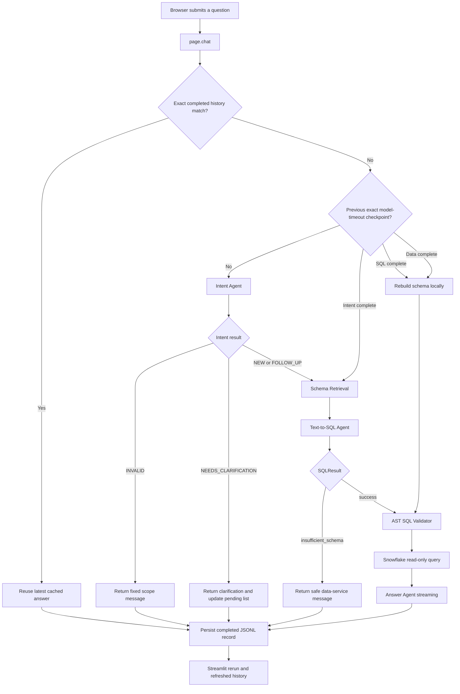

# Census AI | US Population Insights

Explore US Census data through natural language with multi-agent intelligence.

## Web and local usage

### Hosted web application

Open the deployed application at:

<https://census-0blxamkqja9census-ai-agent.streamlit.app/>

1. Enter the GitHub username supplied for evaluation in the **Username** field
   and select **Login**. Alternatively, use `Demo` as the shared evaluation
   username. No password is required.

   **Important: Usernames are case-sensitive. Enter the username with its exact capitalization.**

2. After login, enter a US Census question in the chat input. Follow-up
   questions may refer to the previous conversation context.
3. Use **Log out** before closing the application when possible so the current
   username Session is released immediately.

> **Demo account tip:** Enter `Demo` exactly as shown. `Demo` shares one chat
> history among all reviewers, and the current
> single-instance deployment allows only one browser Session for the same
> username at a time. If `Demo` is already in use, wait for the active user to
> log out or for the inactive Session to expire before trying again. Do not
> enter private or sensitive information.

The hosted deployment reads `ALLOWED_USERS` from private Streamlit Secrets and
does not read the username from `startup/local_config.toml`. Username matching
is exact and case-sensitive.

### Local application

First complete the Gemini and Snowflake configuration described in
[Configuration](#configuration). From the repository root, run:

```powershell
powershell -ExecutionPolicy Bypass -File .\startup\start_win.ps1
```

Then open <http://127.0.0.1:8501> and log in with `user`. Local startup reads
this username from the following setting in `startup/local_config.toml`:

```toml
ALLOWED_USERS = ["user"]
```

Changing that local list changes the accepted local usernames but does not
change the hosted deployment's Streamlit Secrets.

## Architecture

The application uses a layered pipeline so UI state, conversational reasoning,
schema discovery, SQL safety, database access, and persistence remain separate.

| Layer | Responsibility | Main modules |
| --- | --- | --- |
| UI and page state | Login, chat rendering, progress, timed refresh, logout | `streamlit_app.py`, `page.py` |
| Workflow orchestration | Route one request through Intent, data retrieval, and Answer stages | `chat.py` |
| Agents | Guardrails, intent/rewrite/clarification, and grounded answer generation | `agents/` |
| Census data source | Schema Retrieval, Text-to-SQL, SQL validation, Snowflake execution | `data_source/` |
| Supporting services | Gemini access, JSONL history, login ownership, logging | `services/` |
| Startup and configuration | Validate local/remote settings and prepare user files | `cold_start.py`, `startup/` |

### End-to-end workflow



The runtime sequence is:

1. `streamlit_app.py` calls `initialize_application()` before rendering the app.
   `cold_start.py` loads server-first configuration, validates Gemini and
   Snowflake settings, creates `chat_history/`, and ensures every allowed user
   has a JSONL history file.
2. Login is protected by `services/session_service.py`. In the current
   single-instance deployment, one username can own one browser session at a
   time. Explicit logout releases ownership; an abandoned session can be taken
   over after ten minutes of inactivity.
3. After login, `page.load_history()` loads only the latest configured number of
   records. One-minute refreshes merge records by `chat_id`, preserving the
   current in-flight message without displaying it twice.
4. `page.chat()` first checks the currently loaded history for the latest exact,
   completed `NEW` question. A valid match bypasses Gemini and Snowflake. If no
   completed answer exists, only the immediately previous, exactly matching
   `MODEL_UNAVAILABLE` record is eligible for checkpoint recovery.
5. `chat.run_chat_flow()` calls the Intent Agent with the current message,
   recent conversation history, and the current user's pending clarification
   chain. The result is `INVALID`, `NEW`, or `FOLLOW_UP`, plus a clarification
   resolution and a standalone rewritten question.
6. `INVALID` stops immediately. `NEEDS_CLARIFICATION` returns the Agent's
   question and appends to the in-memory pending list. A resolved `NEW` or
   `FOLLOW_UP` continues using the rewritten standalone question; only
   `FOLLOW_UP` supplies relevant history to final answer generation.
7. `schema_retriever.py` searches the local verified SQLite Catalog and returns
   complete metric groups, physical tables, exact columns, geographic filters,
   and verified relationship paths.
8. `sql_agent.py` generates one structured Snowflake `SELECT` result.
   `sql_validator.py` parses it as a Snowflake AST and enforces the retrieved
   table/column allowlist, verified joins, read-only scope, and row limit.
9. `census_data_service.py` validates again immediately before executing the
   query against Snowflake. Returned columns and rows are serialized as
   `data_input` for the current request only; credentials and result rows are
   never written to the SQL log or JSONL history.
10. `answer_agent.py` receives the standalone question and Snowflake data. It
    streams only claims grounded in current data or permitted follow-up history.
    `page.py` stores the completed response after streaming finishes.
11. `history_service.py` appends one JSONL record and Streamlit reruns, making the
    saved history the source of truth for the refreshed UI.

### Runtime behavior and failure paths

- Progress is transient: 5% when text is accepted, 25% after Intent, 60% after
  the Snowflake data-source stage, and 100% when streaming completes. Progress
  is never persisted.
- Intent and Text-to-SQL use complete structured responses. Only the Answer
  Agent streams. All Agents use `gemini-3.5-flash-lite` first and fall back to
  `gemini-3.6-flash` for supported temporary failures.
- The Intent Agent rejects clearly unrelated, non-US, private/individual-level,
  and prompt-injection requests. In-scope ambiguity produces
  `NEEDS_CLARIFICATION`, not an invented interpretation.
- The Answer Agent treats Snowflake rows and permitted previous answers as its
  only factual evidence. Partial coverage produces a partial answer; no usable
  evidence produces a fixed no-data response.
- Schema, SQL, Snowflake, Gemini, and persistence failures return concise English
  UI messages. Technical details remain in server logs without exposing secrets.
- Completed Intent and SQL values are retained in the final or failed JSONL
  record. Snowflake result rows remain in memory only and are never persisted.
  An exact retry after an Answer-model timeout reuses the SQL, queries Snowflake
  again, and then retries answer generation. Logical blocks, quota limits, data
  errors, and older matches always start normally and never reuse checkpoints.
- Each browser session may run only one chat workflow at a time. The input is
  disabled while a request is active and is restored after success or a handled
  failure.

## Repository layout

```text
census-ai-agent/
├── streamlit_app.py                 # Streamlit entry point and login/UI state
├── cold_start.py                    # Configuration loading and startup checks
├── page.py                          # History loading and one-message page handler
├── chat.py                          # Main conversational workflow orchestration
├── requirements.txt                 # Local and deployed Python dependencies
├── README.md                        # Architecture, setup, and operation guide
├── TODO.md                          # Planned production extensions
├── LICENSE
├── test/
│   └── test_chat_resume.py          # Workflow checkpoint recovery tests
├── agents/
│   ├── __init__.py
│   ├── intent_agent.py              # Scope, intent, rewrite, clarification
│   ├── answer_agent.py              # Grounded streamed answer generation
│   └── test/
│       └── test_intent_agent.py
├── data_source/
│   ├── __init__.py
│   ├── schema_retriever.py          # SQLite FTS5 + metric-group retrieval
│   ├── sql_agent.py                 # Schema-grounded Text-to-SQL
│   ├── sql_validator.py             # Snowflake AST safety validation
│   ├── census_data_service.py       # Validated Snowflake execution
│   ├── census_schema_catalog.sqlite
│   ├── census_schema_catalog_verified.sqlite
│   └── test/                        # Retriever, SQL, config, and smoke tests
├── services/
│   ├── __init__.py
│   ├── llm_service.py               # Gemini client, fallback, retry, streaming
│   ├── history_service.py           # JSONL records and pending reconstruction
│   ├── session_service.py           # In-memory single-session ownership
│   ├── logging_service.py           # Process-wide application logging
│   └── test/                        # History and session tests
├── scripts/
│   └── verify_relationships.py      # Build the verified Catalog copy
├── startup/
│   ├── start_win.ps1                # Windows setup and launcher
│   ├── local_config.toml            # Local users and application settings
│   ├── gemini_key.toml              # Local Gemini credential
│   └── snowflake.toml               # Local Snowflake connection settings
├── .streamlit/
│   └── config.toml                  # Non-secret Streamlit runtime settings
└── chat_history/
    └── .gitkeep                     # Per-user JSONL files are ignored by Git
```

Local credential files are shown because they are part of the runtime layout.
Do not publish real credentials; deployed environments should provide them
through Streamlit Secrets or environment variables. Each Python module begins
with a bilingual summary and a list of the functions it owns.

## Module responsibilities

### Entry point and orchestration

| Module | Owns | Does not own |
| --- | --- | --- |
| `streamlit_app.py` | Page configuration, login form, session state, logout, timed refresh, input disabling | Agent prompts, SQL, database access |
| `cold_start.py` | Server-first/local-fallback configuration, validation, startup directories and user files | Chat rendering or query execution |
| `page.py` | `load_history()` and `chat()`, progress rendering, streaming display, final persistence, UI-safe errors | Intent decisions or SQL construction |
| `chat.py` | Stage ordering, year extraction, branch handling, data passed between components | UI widgets or storage implementation |

### Agents

| Module | Responsibility |
| --- | --- |
| `agents/intent_agent.py` | Enforce Census scope, classify `NEW`/`FOLLOW_UP`/`INVALID`, rewrite follow-ups, and request or resolve clarification. It never generates SQL or answers the question. |
| `agents/answer_agent.py` | Judge whether supplied evidence fully or partially covers the request and stream a grounded response. It never queries Snowflake. |

### Census data source

| Module | Responsibility |
| --- | --- |
| `data_source/schema_retriever.py` | Retrieve compact year-aware schema context from the verified Catalog, expand complete composite metrics, resolve supported geography filters, and expose only cataloged relationship paths. |
| `data_source/sql_agent.py` | Convert the standalone question and retrieved schema context into one structured `SQLResult`; it does not execute SQL. |
| `data_source/sql_validator.py` | Parse Snowflake SQL and reject unsafe operations, unknown tables/columns, unverified joins, wildcard selection, and invalid limits. |
| `data_source/census_data_service.py` | Open Snowflake with fixed Census database settings, validate before execution, enforce timeouts, log normalized SQL, and serialize bounded results. |
| `scripts/verify_relationships.py` | Copy the source Catalog and promote only relationships that pass Snowflake null, uniqueness, and coverage checks. |

### Supporting services

| Module | Responsibility |
| --- | --- |
| `services/llm_service.py` | Create the Gemini client, classify provider errors, perform bounded model fallback/retry, and adapt chat messages for Gemini. |
| `services/history_service.py` | Define the JSONL record schema, sanitize usernames, append/load records, rebuild pending state, find exact completed answers, and generate `chat_id` values. |
| `services/session_service.py` | Maintain the process-local username/session registry and inactivity takeover rules for a single application instance. |
| `services/logging_service.py` | Configure application logging and reduce noisy third-party SDK output without using the collision-prone top-level name `logger`. |

## Schema Catalog

The application reads the generated metadata-only Catalog at `data_source/census_schema_catalog_verified.sqlite`. The original input remains at `data_source/census_schema_catalog.sqlite`. Both SQLite files contain `columns`, the FTS5 `field_search` index, `relationships`, and `table_semantics`. `data_source.schema_retriever.retrieve_schema(question, years=[2019, 2020])` opens the verified Catalog once in read-only mode and searches all relevant `{year}_%` tables independently for every requested year, including regular CBG tables, Redistricting tables, and geographic metadata. A single-year request uses `[2019]` or `[2020]`; the application defaults to `[2020]` when the question contains no year.

The Retriever now separates metric discovery from field retrieval. Recognized metrics are expanded from Catalog metadata into complete field groups before any fallback search: total population resolves to the semantic `B01001` total, median household income resolves to its non-additive indicator group, aggregate household income resolves to additive `B19025`, age 65+ includes the total-population denominator and all 12 male/female numerator bands, and owner/renter tenure includes both required members. A bare phrase such as `household income` is not silently treated as a median; the Intent Agent asks the user to choose aggregate or median and explains the state-level aggregation limitation. Multi-metric questions retain every discovered group. Unknown or explicitly subgrouped metrics still use a wider FTS5 candidate pool, but results are balanced across indicator groups so one wide group cannot occupy the entire result window. The response includes `metrics` with physical tables, indicator IDs, required columns, column roles, completeness, and aggregation semantics, plus enriched `tables`, ranked `columns`, JOIN paths, related-table columns, and `warnings`.

Indicator IDs and physical Snowflake tables are intentionally separate. For example, `B01001` is an indicator ID whose physical 2020 table is `2020_CBG_B01`; it must never be converted into an invented table such as `2020_CBG_B01001`. The SQL Agent prompt and SQL Validator both enforce the exact physical tables returned by Schema Retrieval. Regression tests cover unsupported Seattle city mapping, combined population/income retrieval, complete age-65+ expansion, California/Texas population comparison, and basic total-population selection.

For recognized state and county requests, `geographic_context` contains exact `STATE_FIPS` and `COUNTY_FIPS` filters that have also been checked against the geometry-table columns in the Catalog. These filters are applied directly to the matching `{year}_CBG_GEOMETRY_WKT` table with `requires_fips_join = false`; an extra FIPS lookup JOIN is not generated. The California, Texas, Washington, New York, and King County test mappings were checked against Snowflake; King County uses `STATE_FIPS=53` and `COUNTY_FIPS=033`. Multi-state comparisons use OR-ed filter groups. The legacy `geography_filters` field remains for compatibility. A request such as Seattle that lacks a verified city-to-CBG boundary mapping is returned in `unsupported_geographies` and fails closed instead of silently becoming a Washington-wide query. Table-level purpose information is included where `table_semantics` provides it; remaining tables continue to rely on `table_title`, `topics`, `universe`, and `field_path`. For compatibility, a single year can also be passed as `year=2020`; do not pass `year` and `years` together.

Catalog relationships default to `verification_status = "candidate_unverified"`. They are returned as discovery context, but the SQL Agent is instructed not to generate those JOINs and the SQL Validator rejects them. Run `python scripts/verify_relationships.py` to copy the source Catalog and generate `data_source/census_schema_catalog_verified.sqlite`. The script uses read-only Snowflake `SELECT` queries to check key non-nullness, source/target uniqueness, and complete source coverage for every 2019/2020 `cbg_to_geography` candidate; it never changes Snowflake or the source Catalog. In the current Catalog, 65 of 66 CBG-to-geometry relationships passed. `2019_CBG_PATTERNS` remains unverified because its source key contains null and unmatched rows. Other relationship kinds are not implicitly verified and remain blocked until separately checked. The SQL Agent prefers the shortest verified path and does not aggregate CBG-level medians, rates, or percentages into statistically invalid state/county/city values.

The retriever is used by the chat workflow before Text-to-SQL generation. Its real Catalog results have been verified for population, household income, age 65+, housing tenure, geography handling, and physical-table validation.

## Text-to-SQL Agent

`data_source.sql_agent.generate_sql` accepts a question plus the compact context returned by `retrieve_schema`. It returns a Pydantic-validated `SQLResult` with either `success` and one Snowflake SELECT statement, or `insufficient_schema` with a reason and the missing definitions. It only generates SQL; it does not validate or execute the statement.

Run the manual generation smoke test after configuring the Gemini API key. It does not connect to Snowflake:

```powershell
python -m data_source.test.test_sql_agent
```

Before Snowflake execution, `data_source.sql_validator.validate_sql` parses the statement with the Snowflake dialect and rejects multiple statements, non-SELECT operations, wildcard fields, unqualified or unrecognized tables, columns outside the retrieved context, unverified joins, and missing or excessive limits. `data_source.census_data_service.query_census_data` validates again, logs the normalized SQL immediately before the Snowflake call, uses the configured read-only role, applies connection and 30-second statement timeouts, and returns at most 1,000 rows. Credentials and returned rows are never written to this SQL log. Insufficient schema, validation, connection, timeout, and execution failures keep their technical details in server logs, while the chat page returns the user-friendly English message `The Census data service encountered an issue. Please try rephrasing your question or ask a different Census question.` without exposing SQL, schema details, or credentials.

Gemini failures are also degraded gracefully after bounded fallback and retry attempts. A temporary `503` or timeout displays `The AI model is temporarily busy. Please wait a moment and try again.` A `429` quota or rate-limit response displays `The AI model usage limit has been reached. Please wait and try again later.` Technical details remain in server logs, and the displayed message is stored as the completed chat response.

After configuring a valid API key and all Snowflake credentials, run the manual end-to-end test:

```powershell
python -m data_source.test.test_data_source_flow
```

Pass a custom question to inspect the generated SQL and returned data:

```powershell
python -m data_source.test.test_data_source_flow --question "What is the 2020 median household income for 10 Census block groups?"
```

For a cross-year query, include both years in the question. You can also pass
the Catalog years explicitly:

```powershell
python -m data_source.test.test_data_source_flow --years 2019 2020 --question "Compare 2019 and 2020 median household income for 10 Census block groups."
```

To test Snowflake independently without calling GPT, configure only Snowflake and run the fixed, validated 10-row query:

```powershell
python -m data_source.test.test_snowflake_query
```

## Configuration

### Required credentials before startup

The configuration values shown in this repository and in the examples below
are placeholders only. The application cannot run successfully until valid
Gemini and Snowflake credentials have been supplied.

Before starting locally, confirm that:

- `startup/gemini_key.toml` contains a valid `GEMINI_API_KEY`.
- For a new workspace, create `startup/gemini_key.toml` if it is absent and set
  `GEMINI_API_KEY` to a valid Gemini API key.
- `startup/local_config.toml` contains an `ALLOWED_USERS` list and a positive integer `CHAT_HISTORY_LOAD_LIMIT`.
- `startup/snowflake.toml` contains the Snowflake `user`, `account`, credential,
  and warehouse. The expected warehouse for this project is
  `warehouse = "COMPUTE_WH"`.
- The Snowflake credential matches `auth_method`. A token created for one
  authentication method cannot be used with another method.

The tracked `.streamlit/config.toml` contains runtime settings only—never
credentials. It enables headless mode and disables usage-stat collection so a
fresh workspace can start without Streamlit's first-run email prompt or a write
to the user's global `.streamlit` directory.

Example local configuration:

```toml
ALLOWED_USERS = ["user"]
CHAT_HISTORY_LOAD_LIMIT = 50
```

Example PAT configuration in `startup/snowflake.toml` (ignored by Git because it contains credentials):

```toml
[SNOWFLAKE]
auth_method = "PROGRAMMATIC_ACCESS_TOKEN"
account = "YOUR_ORG-YOUR_ACCOUNT"
user = "YOUR_SNOWFLAKE_LOGIN_NAME"
token = "YOUR_PROGRAMMATIC_ACCESS_TOKEN"
warehouse = "COMPUTE_WH"
role = "YOUR_READ_ONLY_ROLE" # Optional if the token/default role already supplies it.
schema = "PUBLIC"
```

The application always uses the fixed Snowflake database
`US_OPEN_CENSUS_DATA_NEIGHBORHOOD_INSIGHTS_FREE_DATASET`; it is not read from
local or server configuration.

Credential requirements are authentication-mode specific:

| `auth_method` | Required credential | Requirement |
| --- | --- | --- |
| `PROGRAMMATIC_ACCESS_TOKEN` | `token` | A Snowflake Programmatic Access Token issued for the configured `user` |
| `oauth` | `token` | A valid OAuth access token |
| `password` | `password` | The configured Snowflake user's password; remove `token` |

The selected token must be accepted by the matching Snowflake connector
`authenticator`; changing only the `auth_method` string does not convert a token
to another authentication type. Never commit any credential. The connector account identifier
uses the `organization-account` form; the Snowflake login name is still required
separately.

On a server, Streamlit Secrets take priority for `GEMINI_API_KEY`,
`ALLOWED_USERS`, and `CHAT_HISTORY_LOAD_LIMIT`. Snowflake accepts the top-level
remote values `SNOWFLAKE_ACCOUNT`, `SNOWFLAKE_WAREHOUSE`, and
`SNOWFLAKE_TOKEN`; each can also be supplied as an environment variable.
Remaining Snowflake settings, and local fallbacks for those three values, come
from `startup/snowflake.toml`.

Example Streamlit Secrets section:

```toml
GEMINI_API_KEY = "YOUR_GEMINI_API_KEY"
SNOWFLAKE_ACCOUNT = "YOUR_ORG-YOUR_ACCOUNT"
SNOWFLAKE_WAREHOUSE = "COMPUTE_WH"
SNOWFLAKE_TOKEN = "YOUR_PROGRAMMATIC_ACCESS_TOKEN"
```

`SNOWFLAKE_ACCOUNT` should normally use the complete `organization-account`
identifier. If the remote secret contains only the account name and it exactly
matches the suffix of the local full identifier, cold start safely restores the
local organization prefix. Full `https://...snowflakecomputing.com` account URLs
are also normalized. The project pins Snowflake Connector 4.8.1 for consistent
Python 3.14 deployment behavior instead of automatically adopting a new major
connector release.

## Chat history

Chat history is stored locally in `chat_history` using JSON Lines (`.jsonl`),
with one completed Q&A or handled-failure snapshot per line. Login loads only
the latest `CHAT_HISTORY_LOAD_LIMIT` records. The directory is retained in Git
through `.gitkeep`, while generated history files are ignored.

Before calling the Intent Agent, the page searches the current user's currently
loaded `CHAT_HISTORY_LOAD_LIMIT` records for an exactly matching original
question (ignoring only leading and trailing whitespace). It searches newest
first, so the most recent completed `NEW` answer is reused immediately,
including its rewritten question and final response, without calling Gemini or
Snowflake again. Pending clarifications, follow-ups, invalid requests, and
technical error responses are never reused. Cache
lookup is disabled while a clarification chain is pending, and users remain
strictly isolated by their own history files.

Each line uses this format:

```json
{"chat_id":"","text":"","rewritten_question":"","time_stamp":"","valid_status":0,"response":"","response_status":0,"sql":"","sql_resp":"","intent_status":"","resolution":"","pending_question":"","pending_clarification":"","pipeline_stage":"","failure_type":""}
```

- `chat_id`: a UUID that uniquely identifies one question/answer record and prevents duplicates during timed refresh.
- `text`: the original user input displayed in the chat UI.
- `rewritten_question`: the standalone question produced by the Intent Agent and used for Agent history, Schema Retrieval, Text-to-SQL, and answer generation. Legacy rows fall back to `text`.
- `valid_status`: `0` means valid; `-1` means invalid. Invalid records keep `response` empty and the page displays `I cannot answer that question.`
- `response_status`: `0` means completed; a non-zero value is reserved for an in-memory request that is still processing. If model processing fails, the English service-error response is stored as a completed record so history refreshes do not duplicate a user-only pending question. This is separate from semantic clarification state.
- `intent_status`: stores `INVALID`, `NEW`, or `FOLLOW_UP`, allowing history reloads to truncate the pending chain at a `NEW` boundary.
- `resolution`: stores `NONE`, `NEEDS_CLARIFICATION`, or `RESOLVED_PENDING`. `FOLLOW_UP` controls whether answer generation receives recent history; `NEEDS_CLARIFICATION` ends the current pipeline immediately and returns the Intent Agent's clarification question.
- `sql` stores the generated query so an eligible retry can resume without
  regenerating it. `sql_resp` is retained only for legacy JSONL compatibility;
  all new records keep it empty so Snowflake query results are never persisted.
- `pipeline_stage` records the last completed stage: `RECEIVED`,
  `INTENT_COMPLETE`, `SQL_COMPLETE`, `DATA_COMPLETE`, or `ANSWER_COMPLETE`.
  `DATA_COMPLETE` confirms that the query completed during that attempt, but
  only the Intent result and SQL are durable. A resumed request executes that
  SQL again instead of restoring prior Snowflake rows.
- `failure_type` distinguishes resumable `MODEL_UNAVAILABLE` failures from
  `MODEL_RATE_LIMIT` and ordinary `SERVICE_ERROR` failures. Only the immediately
  previous exact question with `MODEL_UNAVAILABLE` and a complete checkpoint is
  resumed. Technical error responses are displayed in history but excluded from
  subsequent Agent conversation context and completed-answer caching.
- `pending_question` and `pending_clarification` store this user's clarification snapshot after the turn. Login and the one-minute history refresh replay `resolution` events to rebuild at most the latest five unresolved items, starting after the latest `NEW` boundary. The list is kept in the browser's Streamlit session and is not shared between users.

## Run on Windows

Complete the required credential configuration above before running the startup
script. In particular, configure `startup/gemini_key.toml` and set valid
`user`, `account`, authentication credential, and
`warehouse = "COMPUTE_WH"` values in `startup/snowflake.toml`.

The startup script creates or reuses `.venv`, installs dependencies, and starts Streamlit:

```powershell
powershell -ExecutionPolicy Bypass -File .\startup\start_win.ps1
```

## Run manually

The same Gemini and Snowflake credential requirements apply to manual startup.

```powershell
pip install -r requirements.txt
streamlit run streamlit_app.py
```

Run the manual commands from the repository root so Streamlit discovers
`.streamlit/config.toml`. The Windows startup script changes to that directory
automatically and also passes the same safe settings explicitly.
